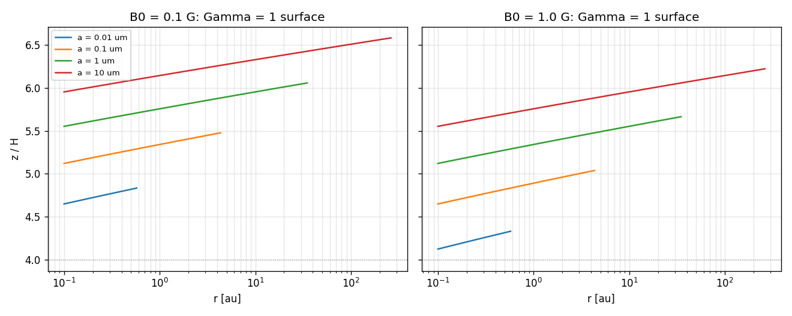

# Charged grains in the fossil field (generated by scripts/hall_map.py)

OML surface potential psi = -3.857 (m_i = 29 amu). Field B_z = B0 (r/au)^-1.25, B_r = 0.5 B_z.
z_1 / H: height above which the Hall parameter exceeds 1 (0: already at the midplane;
'-': |Z| < 1, OML not applicable).

## B0 = 0.1 G

| a | r = 1 au | 10 au | 100 au | Gamma_mid at 1 au |
|---|---|---|---|---|
| 0.01 um | - | - | - | 6.40e-06 |
| 0.1 um | 5.34 | - | - | 6.40e-07 |
| 1 um | 5.75 | 5.95 | - | 6.40e-08 |
| 10 um | 6.14 | 6.33 | 6.51 | 6.40e-09 |

## B0 = 1.0 G

| a | r = 1 au | 10 au | 100 au | Gamma_mid at 1 au |
|---|---|---|---|---|
| 0.01 um | - | - | - | 6.40e-05 |
| 0.1 um | 4.89 | - | - | 6.40e-06 |
| 1 um | 5.34 | 5.55 | - | 6.40e-07 |
| 10 um | 5.75 | 5.95 | 6.14 | 6.40e-08 |

