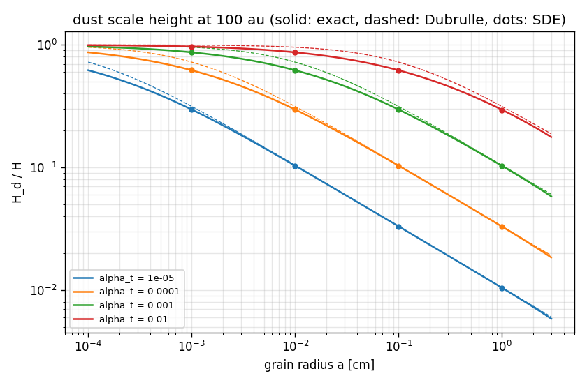

# Vertical settling with turbulent mixing (generated by scripts/settling.py)

r = 100.0 au, paper's analytic disk. H_d = sqrt(<z^2>) of the stationary dust distribution.
Columns: exact zero-flux solution, Dubrulle et al. (1995), stochastic simulation (20 000 paths,
linear-implicit Euler, 10 relaxation times; +- 1 sigma).

| alpha_t | a [cm] | St_mid | H_d/H exact | H_d/H Dubrulle | Dubrulle error | H_d/H SDE |
|---|---|---|---|---|---|---|
| 1e-05 | 0.001 | 9.07e-05 | 0.2973 | 0.3151 | +6.0% | 0.2963 +- 0.0014 |
| 1e-05 | 0.01 | 0.000907 | 0.1036 | 0.1044 | +0.8% | 0.1030 +- 0.0005 |
| 1e-05 | 0.1 | 0.00907 | 0.0332 | 0.0332 | +0.1% | 0.0331 +- 0.0002 |
| 1e-05 | 1 | 0.0907 | 0.0105 | 0.0105 | +0.4% | 0.0104 +- 0.0001 |
| 0.0001 | 0.001 | 9.07e-05 | 0.6215 | 0.7241 | +16.5% | 0.6232 +- 0.0028 |
| 0.0001 | 0.01 | 0.000907 | 0.2973 | 0.3151 | +6.0% | 0.2963 +- 0.0014 |
| 0.0001 | 0.1 | 0.00907 | 0.1036 | 0.1044 | +0.8% | 0.1030 +- 0.0005 |
| 0.0001 | 1 | 0.0907 | 0.0330 | 0.0332 | +0.5% | 0.0329 +- 0.0002 |
| 0.001 | 0.001 | 9.07e-05 | 0.8699 | 0.9575 | +10.1% | 0.8721 +- 0.0039 |
| 0.001 | 0.01 | 0.000907 | 0.6215 | 0.7241 | +16.5% | 0.6230 +- 0.0028 |
| 0.001 | 0.1 | 0.00907 | 0.2972 | 0.3151 | +6.0% | 0.2964 +- 0.0014 |
| 0.001 | 1 | 0.0907 | 0.1032 | 0.1044 | +1.2% | 0.1027 +- 0.0005 |
| 0.01 | 0.001 | 9.07e-05 | 0.9691 | 0.9955 | +2.7% | 0.9690 +- 0.0047 |
| 0.01 | 0.01 | 0.000907 | 0.8699 | 0.9575 | +10.1% | 0.8721 +- 0.0039 |
| 0.01 | 0.1 | 0.00907 | 0.6214 | 0.7241 | +16.5% | 0.6231 +- 0.0028 |
| 0.01 | 1 | 0.0907 | 0.2960 | 0.3151 | +6.5% | 0.2949 +- 0.0014 |

