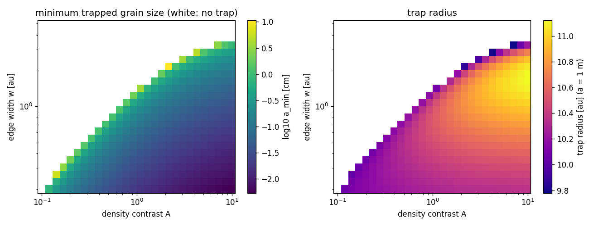
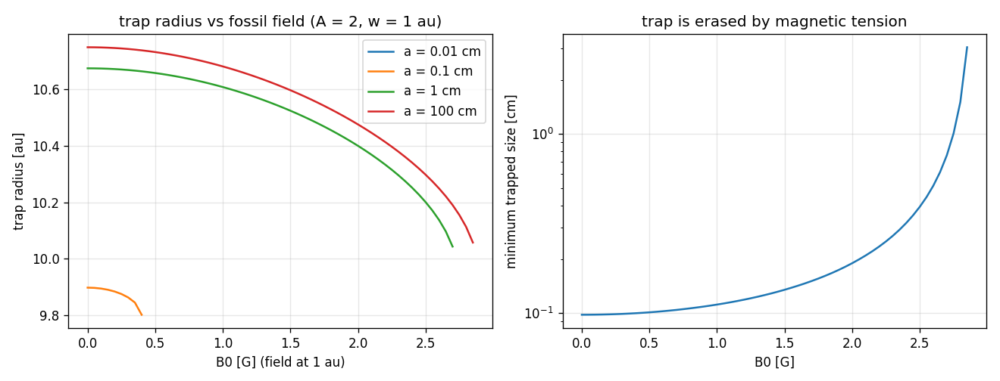

# Dust traps at a dead-zone edge with a fossil field (generated by scripts/trap_map.py)

Analytic disk of the paper (alpha = 0.01, Mdot = 1e-8 Msun/yr), beta_K from Eq. (16), edge at
r_b = 10 au with density contrast 1 + A and width w; fossil field B_z = B0 (r/au)^-1.25, B_r = 0.5 B_z.
ILLUSTRATIVE disk structure (no Belmondo tables).

## Trapping threshold of the edge (no field)

| w [au] | A_crit | a_min at A = 2 [cm] |
|---|---|---|
| 0.3 | 0.158 | 0.0178 |
| 0.5 | 0.277 | 0.0335 |
| 1.0 | 0.64 | 0.098 |
| 2.0 | 1.83 | 2.2 |
| 3.0 | 4.61 | nan |

## Effect of the fossil field (A = 2, w = 1 au)

Magnetic tension raises beta_K; the trap disappears for B0 > 2.85 G (grid step 0.05 G),
i.e. B_z(10 au) > 0.160 G.

| B0 [G] | a_min [cm] | r_trap(1 cm) [au] | r_trap(1 m) [au] |
|---|---|---|---|
| 0.0 | 0.098 | 10.67 | 10.75 |
| 0.5 | 0.101 | 10.66 | 10.73 |
| 1.0 | 0.112 | 10.61 | 10.68 |
| 1.5 | 0.135 | 10.52 | 10.6 |
| 2.0 | 0.19 | 10.4 | 10.48 |
| 2.5 | 0.392 | 10.2 | 10.3 |
| 3.0 | nan | nan | nan |

