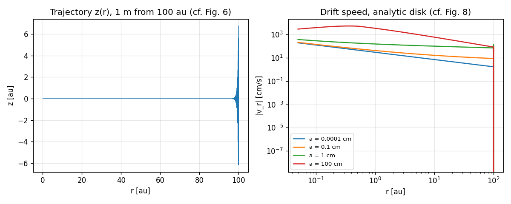
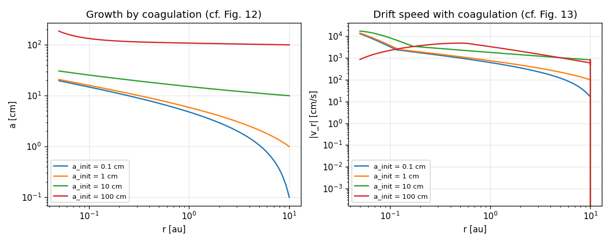

# Validation against Kobozeva (2025)

Generated by `scripts/compare_paper.py` (do not edit by hand). Default (paper) parameters,
analytic disk, calibrated sigma_mol = 1e-16 cm^2 and settle_eps = 0.005 (see physics_model.md).
'ok' = within 5 % (paper values have 2-3 significant figures).

## Table 1: sedimentation times [yr]

| r_init [au] | a [cm] | paper | first entry | last entry | ratio (best) |  |
| --- | --- | --- | --- | --- | --- | --- |
| 1 | 1 | 42.5 | 41.53 | 41.53 | 0.9772 | ok |
| 1 | 10 | 3.8 | 3.912 | 3.912 | 1.03 | ok |
| 1 | 100 | 2.7 | 0.2615 | 2.733 | 1.012 | ok |
| 10 | 1 | 564 | 552.9 | 552.9 | 0.9804 | ok |
| 10 | 10 | 9.3 | 13.16 | 27.76 | 1.415 | **differs** |
| 10 | 100 | 8.1 | 8.031 | 220 | 0.9915 | ok |
| 50 | 100 | 89.5 | 89 | 4388 | 0.9945 | ok |
| 100 | 100 | 252 | 251.1 | 1.631e+04 | 0.9966 | ok |

## Table 2: radial-drift times without coagulation [yr] (2D: sedimentation on)

| r_init [au] | a [cm] | paper | dustppd | ratio |  |
| --- | --- | --- | --- | --- | --- |
| 1 | 0.0001 | 8700 | 9612 | 1.105 | **differs** |
| 1 | 0.1 | 6400 | 7304 | 1.141 | **differs** |
| 1 | 1 | 2400 | 2383 | 0.993 | ok |
| 1 | 10 | 322 | 316.5 | 0.9829 | ok |
| 1 | 100 | 98.2 | 100.8 | 1.027 | ok |
| 10 | 0.0001 | 3.44e+05 | 4.079e+05 | 1.186 | **differs** |
| 10 | 0.1 | 1.55e+05 | 2.071e+05 | 1.336 | **differs** |
| 10 | 1 | 4e+04 | 3.981e+04 | 0.9952 | ok |
| 10 | 10 | 4900 | 4827 | 0.9851 | ok |
| 10 | 100 | 4500 | 4444 | 0.9876 | ok |
| 50 | 0.0001 | 4.6e+06 | 5.569e+06 | 1.211 | **differs** |
| 50 | 0.1 | 1.2e+06 | 1.783e+06 | 1.486 | **differs** |
| 50 | 1 | 1.83e+05 | 2.603e+05 | 1.423 | **differs** |
| 50 | 100 | 8.5e+04 | 8.418e+04 | 0.9903 | ok |
| 100 | 0.0001 | 1.42e+07 | 1.716e+07 | 1.209 | **differs** |
| 100 | 0.1 | 2.9e+06 | 4.315e+06 | 1.488 | **differs** |
| 100 | 1 | 3.98e+05 | 5.784e+05 | 1.453 | **differs** |
| 100 | 100 | 3.06e+05 | 3.047e+05 | 0.9956 | ok |

## Table 4: radial-drift times with coagulation [yr] (radial drift only, as jord++)

| r_init [au] | a [cm] | paper | dustppd | ratio |  |
| --- | --- | --- | --- | --- | --- |
| 1 | 0.0001 | 7100 | 7049 | 0.9928 | ok |
| 1 | 0.1 | 2900 | 2858 | 0.9855 | ok |
| 1 | 1 | 1200 | 1181 | 0.9842 | ok |
| 1 | 10 | 262 | 256 | 0.9771 | ok |
| 10 | 0.1 | 6.7e+04 | 6.612e+04 | 0.9869 | ok |
| 10 | 1 | 2.2e+04 | 2.226e+04 | 1.012 | ok |
| 10 | 10 | 4300 | 4294 | 0.9986 | ok |
| 50 | 0.1 | 5.56e+05 | 5.653e+05 | 1.017 | ok |
| 50 | 1 | 1.65e+05 | 1.643e+05 | 0.9957 | ok |

## Fig. 12 / Table 3: growth from 10 au (coagulation, radial drift only)

| a_init [cm] | a_max paper | a_max dustppd | t paper [yr] | t dustppd [yr] | v_max paper [m/s] | v_max dustppd [m/s] |
| --- | --- | --- | --- | --- | --- | --- |
| 0.1 | 15 | 19.7 | 6.7e+04 | 6.612e+04 | 24.3 | 131.1 |
| 1 | 21 | 20.89 | 2.2e+04 | 2.226e+04 | 123.9 | 141 |
| 10 | 30 | 30.67 | 4300 | 4294 | 55.1 | 173.6 |
| 100 | 125 | 186.6 | 4500 | 4490 | 157.1 | 48.6 |

## Reference case: 1 m from 100 au (Sec. 3.3-3.4, Figs. 6-7)

| quantity | paper | dustppd |
| --- | --- | --- |
| t_sed [yr] | 252 | 251.1 |
| t_drift [kyr] | 306 | 304.7 |
| max abs(v_r) [m/s] | 58.5 | 54.63 |
| r at max |v_r| [au] | 0.31 | 0.363 |
| abs(v_r) at r_in [m/s] | 33.5 | 29.67 |

